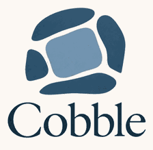

  

# Cobble
Cobble is an Inky Tech project.

**Inky Tech Pty Ltd**   
Infrastructure of memory.

_Memory is the masterpiece.  
Intelligence is paint._

## The application

Cobble is an app designed to cobble together an entity from information sources and intelligence sources. One of its aims is sovereignty, so that the information is held and backed up in locations that are controlled by the user. The sources of intelligence are modular and pluggable, reducing the dependency on any single supplier.

The centrepiece of the app is a 'room', which draws its inspiration and much of its language from a meeting room.

A room is created by a convenor, who appoints a chair, tables an agenda, and invites participants. The chair brings a set of standing orders. The convenor can accept those standing orders as-is, or make changes to them if required. The contributions of all participants are 'tabled'. The information on the table acts as context for the ongoing discussion. To some extent the convenor can control the sensitivities of information by choosing what is on the table at the start of the meeting, and by choosing participants. Once the other intelligences are in the room, they can table whatever information they see fit, but they might like to 'show judgement' to guard their reputation, as will be seen further below.

One of the functions of the standing orders is to create a process so that the meeting can speak with a single voice. The process of achieving a single voice might enforce a strict hierarchy between the intelligences at the table, or it might implement something more democratic — different chairs can table standing orders that encode different approaches.

All seats at the table are occupied by intelligences. These can be human or AI ... but a third possibility emerges: Because a room can speak with a single voice, a room is _also_ an intelligence. A room can be invited to 'take a seat' in another room.

The ability to plug one room into another creates a different view of the cobbled-together entity. In one sense the entity is cobbled together from intelligences and information sources. In a different sense it is cobbled together from rooms.

A natural observation is that we can scale up this entity. We can create a department out of rooms, and an organisation out of departments.

It is the intention of the project that the 'room' concept should also scale down. The room has multiple input streams, code on the table, and a single output stream. Inputs are transformed by code into outputs. The room is a program.

As we run the thought experiment toward smaller scales, we can see that some of the roles are not compulsory. A room only needs to 'speak with one voice' if it is going to be plugged into another room. The chair and the standing orders are not compulsory. A room will consume resources, but these resources do not necessarily have to come from a convenor: the convenor is not compulsory.

At the smallest scale we notice a possible room architecture that is uncannily similar to that of a neuron: a set of inputs, a tiny scrap of code and the occasional whack of electricity on a single channel output.

Convenors care about the economics of a room. They want results *at a price*. This creates markets for intelligences, for chairs and for rooms. In the operation of a meeting, the intelligences are invited to table new material. In a high level room, this material might resemble something like 'ideas' or 'vibe code'. In a lower-level room we might expect something more structured and compact. Either way, a good chair will have rules to manage this code. These rules could be maximalist along the lines of Git, or they could be minimalist along the lines of a meeting that strips its output back to just a set of minutes.

A room can employ intelligences, human or otherwise, invited by the convenor in the hope of useful output. These intelligences might charge for their services. As it stands in November 2026, the prototype app can connect to three LLM 'intelligences', Claude, GPT and Mistral. The Cobble prototype displays the estimated cost of each LLM, and the total cost of the meeting. A future version of the app will allow intelligences to _pay_ to attend a meeting. A meeting might turn a profit. A 'customer' intelligence might take a seat to copy code from the table, and then use it to convene another room, or use it elsewhere, outside Cobble. In this way, the code on the table can reproduce. A customer might also be interested in the institutions and working habits of the room. This is also reproduction, but in the 'softer' sense of transmission rather than replication.

Cobble also allows connection to a range of information sources. On our test server, we have connected two filesystems, six GitHub repos and an archive of chat with GPT.

The app makes a distinction between this external data and the data that has been internalised into the entity. The external data is labelled 'sensory' ... it is a taste of the outside world. It is voluminous, multiply redundant, and much of it is not particularly salient. We want to test whether this information can be ingested by expert systems — rooms — that are under economic pressure to leave a salient representation of it 'on the table'. We are calling this internalised data *memory*. As the app matures, we hope to add 'sensory' sources — email, databases, social media ... and also a browser and search engine so that the entity can turn its senses toward an object of interest.

## Sister project. Governance

The project intersects with its sister-repo [Village Link](https://github.com/Inky-Tech-Pty-Ltd/VillageLink) at the point of the *reputations* of the intelligences, chairs, convenors, and rooms. Village Link proposes a *star credential* as a way of bundling evidence about an entity. A star credential is a way of making an assertion about the things an entity has touched, and the things that have touched the entity. The 'door' function of the room is to assess opportunities and threats at the membrane. This function is a potential consumer of star credentials. Star credentials are like advertising. We are tempted to extend our metaphor by plastering star credentials on the outward-facing windows of the room.

The room can have some or all of these features: A convenor, a chair, a table, seats at the table, standing orders, a unitary outbound 'voice', modular connections to other rooms, a reputation, windows, reputational information posted on the windows, customers, suppliers, a balance sheet and an income statement.

These features suggest a small set of primitives, from which many kinds of rooms might be assembled. We imagine a programming language called 'Room'. We are thinking of a future where the rooms themselves — and progressively much of Cobble is written in Room. Beneath this would sit a small kernel responsible for instantiating rooms, connecting them, accounting for resources and enforcing boundaries.

Together, the 'Cobble' project and the 'Village Link' project pose a hypothesis for testing: Can we observe normative institutions as emergent structures arising from the interactions of markets and reputation? Can we observe *governance*?

## Value proposition

1. Sovereignty. Reduced vulnerability to the loss of any single intelligence, AI or human.
1. Context, ownership. Layered stores of information 'on the table' and 'in the senses', all controlled by the user.
1. Workspaces, coherence. Each AI voice available to two or more people, all with the shared context of a meeting room.
1. Learning. An entity capable of continual learning through real-world encounters.
1. Evolvability, modularity. A mature Cobble will ship with a default set of rooms. (For example for the ingestion of email, the optimisation of tabled code, or the deployment of a trust engine.) Any of these may be swapped-out for something better.
1. Governance? Resource pressure as an organising principle. Rooms, chairs and intelligences selected on reputation. 'Natural' data permission _in the room_.

