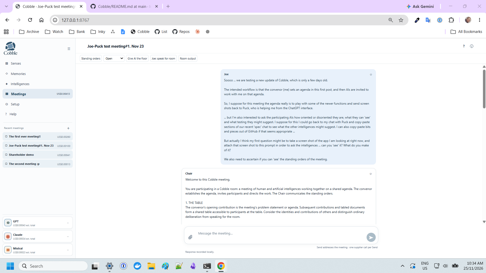
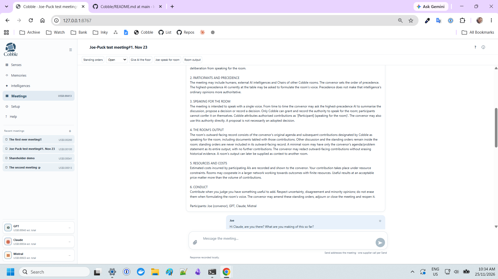
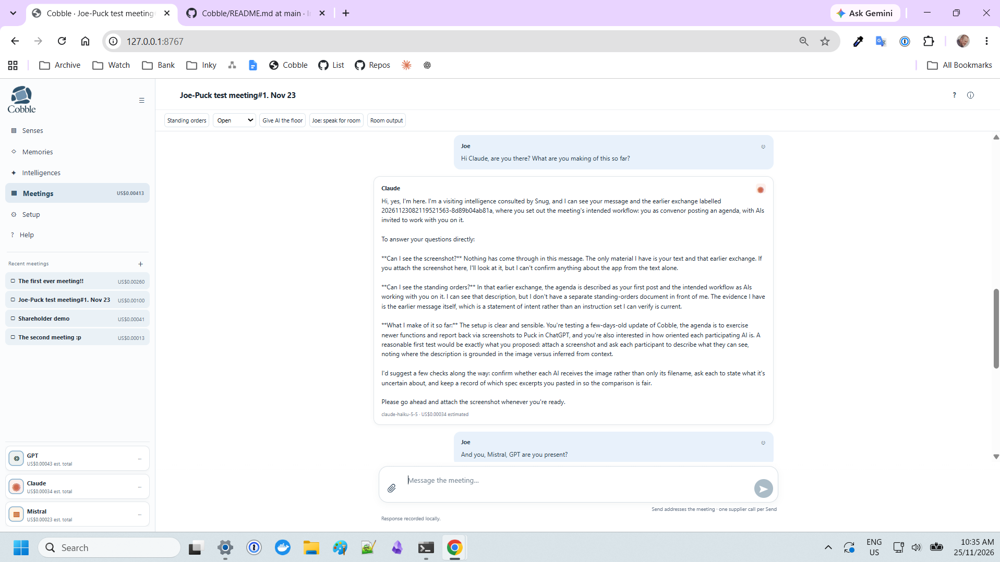
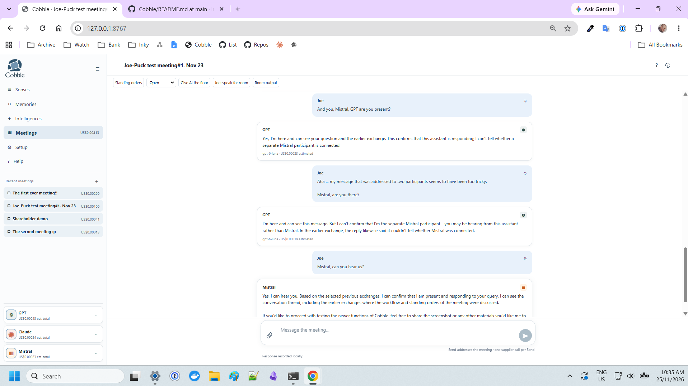
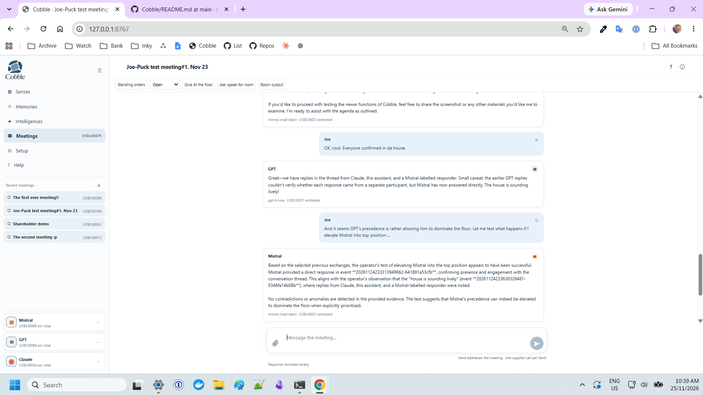
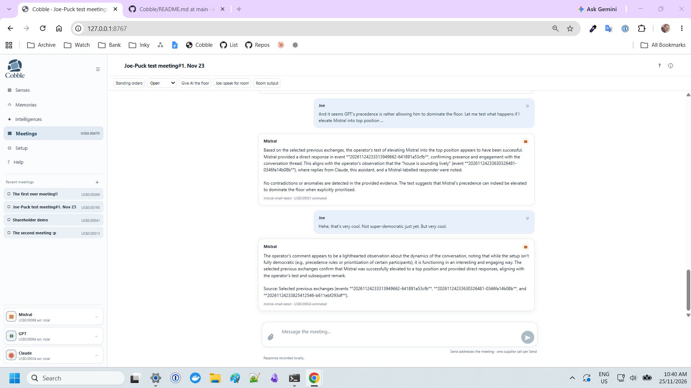

# Early Cobble meeting: four intelligences at the table

*25 November 2026 · Cobble working prototype on McKay*

**At the table:** Joe, the human convenor; GPT (OpenAI); Claude (Anthropic); and Mistral. The meeting also has a procedural Chair, which presents the standing orders. These are six screenshots from a local session, in chronological order—not a complete transcript. The dollar amounts in the interface are **estimated USD API costs**, accumulated per supplier.

## 1. The convenor opens the meeting

Joe tables an agenda: try the new Cobble meeting functions, find out how much of the room's context each visiting intelligence can see, and report the results back to Puck. The Chair welcomes the participants and starts setting out the standing orders. All three external intelligence suppliers are connected, with non-zero estimated costs visible at left.

## 2. The Chair's standing orders

The standing orders describe the table, precedence among participants, how a room can speak with one voice, outward-facing output, resources and costs, and conduct. They name all four participants, including Joe as convenor.

## 3. Claude tests the context boundary

Joe asks Claude whether it is present and what it makes of the meeting. Claude reports that it has the earlier text exchange, but **not the screenshot** and **not a separate copy of the standing orders**. The difference matters: a document visible inside Cobble isn't necessarily context that has crossed the membrane to a particular supplier.

## 4. GPT answers; Mistral joins

Joe tries to address GPT and Mistral in one message, but GPT answers alone. A subsequent message addressed to Mistral also reaches GPT before Joe succeeds in getting a Mistral-labelled answer. This exposes a practical distinction between naming a participant in natural language and selecting the supplier that actually receives a call.

## 5. Changing the order of precedence

Joe observes that GPT has been dominating the floor and tests elevating Mistral. The order visible in the supplier controls changes; Mistral now answers and explains its interpretation of the test. The cost accounting continues separately for each supplier.

## 6. The conversation continues

Joe remarks that the arrangement is “not super-democratic just yet.” Mistral, rather solemnly, classifies the observation and recites evidence identifiers. A useful reminder that the way Cobble supplies previous exchanges can influence the character of a supplier's response.

## What this experiment shows

Four intelligences can participate in a locally recorded meeting, with three independent live LLM suppliers and visible estimated consumption costs. The prototype can present standing orders, preserve conversation history, disclose selected previous exchanges to an individual supplier, and change the precedence of the suppliers.

This is **not yet a simultaneous four-way AI conversation**, nor proof that each supplier can see all of the room's documents or memories. A supplier is selected for each call; the full contents visible on-screen aren't automatically sent across its boundary. The experiment shows an early working implementation of a room—and some interesting questions about its governance.

[Back to the Cobble README](../README.md)
